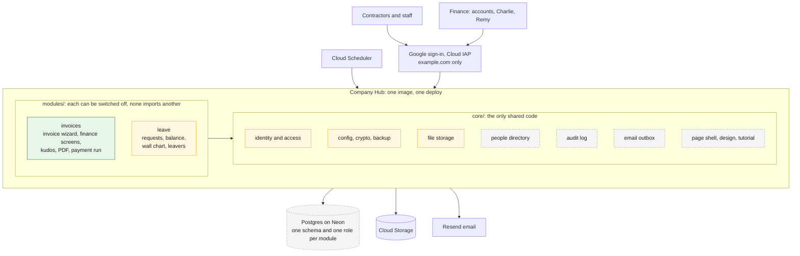
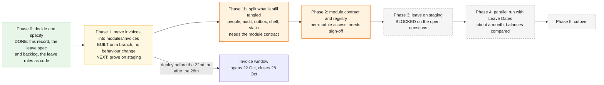

# 0001. A modular hub: invoices and leave in one app

**Status: proposed, Phase 1 built on a branch.** What you have said is marked
*decided*; everything else is a proposal that nobody has agreed to yet.
**Date:** 7 October 2026.

## Context

The invoice portal is live and works. You want to keep adding internal tools to
it without each one becoming a separate system, and the first is a replacement
for Leave Dates (leavedates.com), for the whole team. The reasons you gave:
owning the tool, our own rules and branding, integration with our other internal
tools, and no per-user fees as we grow. It is not mainly about cost.

The invoice app was already well layered: a pure `domain/`, then `services/`,
then `web/`, with a test that fails the build if the domain does I/O. What it did
not have was a boundary around *itself*. Everything was `app/`, so a second tool
built beside it would have shared its tables, its settings and its access rules
by default.

## Decided and proposed

| | | |
|---|---|---|
| The hub holds **invoices and leave**, and nothing else for now | **Decided** | More modules later |
| **The chat assistant is not part of it.** It is a separate system, used only as a style reference for a modular layout | **Decided** | |
| Reuse this system's stack and Google sign-in | **Decided** | Python, FastAPI, HTMX, Postgres on Neon, Cloud Run behind IAP, Terraform, Resend |
| Plan first, **staging first**, nothing on production until proven there | **Decided** | |
| **Phase 1: move the invoice app into `modules/invoices/`** | **Decided** (7 October) | Built on branch `hub-phase-1`. Not merged and not deployed |
| One service, one image, one deploy, not a service per module | Proposed | A service per module would mean another IAP configuration, set of secrets and scheduler identity each, and would break the £0 target |
| `core/` shared, `modules/<name>/` self-contained, and **tests that fail when a wall is crossed** | Proposed | Built; see below |
| One database schema and **one database role per module** | Proposed | Not built. Needs a decision (H-04) |
| Access per module instead of the single finance list | Proposed | Touches non-negotiable §2.1, so it needs explicit sign-off (H-03) |
| `/` becomes a module chooser; `/invoices`, `/leave`; permanent redirects for old paths | Proposed | Live emails link to the old paths (H-05) |
| Do **not** rename the Cloud Run services | Proposed | The name sets the IAP audience (H-08) |

## The architecture

**Reading it:** green is live in production, yellow is built on a branch and not
deployed, and dashed grey is planned. Invoices is still live exactly as it was;
the move is on a branch. `core/` holds the infrastructure that depended only on
configuration. The people directory, the audit log, the outbox and the page shell
are still inside `modules/invoices`, and why is below.

## The rules, and what enforces them

| Rule | Enforced by |
|---|---|
| `core/` imports nothing above it: no module, not `app` | `tests/architecture/test_boundaries.py` |
| A module never imports `app` | `tests/architecture/test_boundaries.py` |
| A module never imports another module | `tests/architecture/test_boundaries.py` |
| A module's `domain/` uses only the standard library and itself | `tests/architecture/test_boundaries.py`, and `tests/domain/test_purity.py`, which walks every `modules/*/domain` |
| A module's `domain/` never reads the clock; every date is a parameter | `tests/architecture/test_boundaries.py` |
| `app/` is the one place allowed to import both core and the modules | by construction: it is the composition root |
| A module cannot read another module's tables | not yet, needs H-04 |

## What is built and what is not

| | State |
|---|---|
| `modules/leave/domain/`: leave year, half-day counting, requests, the ledger, the leaver formula, the birthday rule | **Built and tested**, 120 tests, nothing wired in |
| `modules/leave/SPEC.md`, `BACKLOG.md` | Written |
| `modules/invoices/`: the whole invoice app, moved with `git mv` so history is kept | **Built on `hub-phase-1`.** 48 routes identical to `staging`, in the same order |
| `core/`: config, auth, transport, database session, encryption, file storage, backup, CSRF, theme, the rate-limit mechanism | **Built on `hub-phase-1`** |
| The boundary tests | **Built** |
| The image | **Built and booted locally:** contains `core/` and `modules/`, serves the health check and static files, and refuses unauthenticated requests |
| `app/` | Reduced to the entrypoint and the single migration chain, so `uvicorn app.main:app` and `alembic.ini` are unchanged |
| The module contract and registry, per-module access, per-module schema and role, the landing page | Not started |
| Any leave screen, table or stored data | Not started. Blocked on `modules/leave/BACKLOG.md` |

## The plan

| Phase | Gate to leave it |
|---|---|
| 0. Decide and specify | **Done.** You sign off the spec and the answers to the open questions |
| 1. Repackage | **Met on the branch:** the existing tests pass with import paths changed and no assertion touched, and the route table is identical. **Still to do:** staging verified, and production only outside an invoice window |
| 1b. Split the tangled files | Each split is its own commit, with the suite green and the route table identical |
| 2. Contract | Architecture tests green with invoices as the only registered module; the access change provably identical in effect for invoices |
| 3. Leave on staging | A leave spec signed off; staging holds invented people only |
| 4. Parallel run | A report of every person whose balance differs from Leave Dates, and each difference explained |
| 5. Cutover | Balances match |

### What is still in `modules/invoices`, and why

These hold both shared machinery and invoice-specific content. Each was left
because splitting it needs a design decision that the module contract (Phase 2)
makes, and doing it now would mean inventing that contract by accident.

| File | What has to happen |
|---|---|
| `db/models.py` | `Person`, the audit log, the outbox and `Base` belong in `core`. `Person` has relationships to fees, bank details and invoices, and carries two invoicing columns (`kudos_eligible`, `payout_region`); moving it without a migration means the relationships are declared from the invoice side |
| `db/repo.py` | The person, audit and outbox queries to `core`; the rest stays |
| `services/mailer.py` | The transport, the outbox and the dispatcher to `core`; the invoice, bank and reminder email content stays, registered by kind |
| `web/templates.py`, `web/tutorial.py` | The engine to `core`; each module registers its own filters, globals and tutorial copy |
| `templates/base.html` and `static/` | The shell and its stylesheet, scripts and fonts to `core`; the navigation becomes module-driven, which is what the contract is for |
| `config.py`'s `Settings` | One class holds every setting. It moved to `core` whole; the invoice-specific fields (kudos, bank key, PDF) should come back out |
| `web/static.py` | Its root is a module path today; it needs to serve more than one root |

## Consequences

- **Moving files was reversible and cheap; deploying it under live submissions is
  not.** That is the only reason Phase 1 has a window.
- **Nothing visible changes until leave has a screen.** The return on all of this
  arrives with the second and third module.
- **Leave cannot get past its pure rules until Phase 1b.** It needs the person,
  the audit log, the outbox and the shell, and those are the tangled files above.
  That is no loss today, because leave is blocked on answers for longer than it
  takes to do.
- **HR data is a different class from fees.** It is the reason for H-04 and H-09,
  and the reason no leave data is stored until its handling is decided.

## Alternatives considered

| | Why not |
|---|---|
| A separate service per module | Another IAP configuration, set of secrets and scheduler identity each, a second database, and the end of the £0 target, to isolate two modules with fewer than twenty users |
| Folding in the chat assistant | Different runtime, different front door, live pilot, and you said it is a separate system |
| Building leave as a standalone app | Duplicates sign-in, audit, mail and deployment, which is exactly what the hub removes |
| Splitting every mixed file in the first pass | The riskiest part of the work, and it would have meant designing the module contract by accident. Moving first and extracting after kept every step small and checkable |

## The decision needed now

**Prove Phase 1 on staging, and when?**

The branch is built and verified locally. The remaining step is to deploy it to
the staging environment and look at it. The next invoice window opens on **22
October**, 15 days from now, and closes on the 28th. Deploying to staging is
safe at any time; the window only matters for production.
