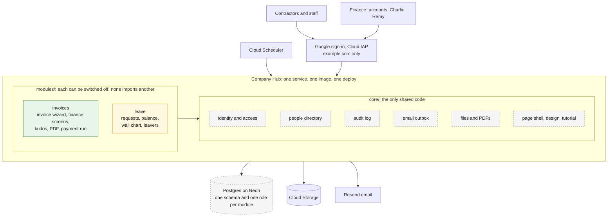
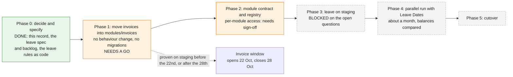

# 0001. A modular hub: invoices and leave in one app

**Status: proposed.** What you have said is marked *decided*; everything else is a
proposal that nobody has agreed to yet. **Date:** 7 October 2026.

## Context

The invoice portal is live and works. You want to keep adding internal tools to
it without each one becoming a separate system, and the first is a replacement
for Leave Dates (leavedates.com), for the whole team. The reasons you gave:
owning the tool, our own rules and branding, integration with our other internal
tools, and no per-user fees as we grow. It is not mainly about cost.

The invoice app is already well layered: a pure `domain/`, then `services/`, then
`web/`, with a test that fails the build if the domain does I/O. What it does not
have is a boundary around *itself*. Everything is `app/`, so a second tool built
beside it would share its tables, its settings and its access rules by default.

## Decided and proposed

| | | |
|---|---|---|
| The hub holds **invoices and leave**, and nothing else for now | **Decided** | More modules later |
| **The chat assistant is not part of it.** It is a separate system, used only as a style reference for a modular layout | **Decided** | |
| Reuse this system's stack and Google sign-in | **Decided** | Python, FastAPI, HTMX, Postgres on Neon, Cloud Run behind IAP, Terraform, Resend |
| Plan first, **staging first**, nothing on production until proven there | **Decided** | |
| One service, one image, one deploy, not a service per module | Proposed | A service per module would mean another IAP configuration, set of secrets and scheduler identity each, and would break the £0 target |
| `core/` shared, `modules/<name>/` self-contained, and **tests that fail when a wall is crossed** | Proposed | Built for leave only; see below |
| One database schema and **one database role per module** | Proposed | Not built. Needs a decision (H-04) |
| Access per module instead of the single finance list | Proposed | Touches non-negotiable §2.1, so it needs explicit sign-off (H-03) |
| `/` becomes a module chooser; `/invoices`, `/leave`; permanent redirects for old paths | Proposed | Live emails link to the old paths (H-05) |
| Do **not** rename the Cloud Run services | Proposed | The name sets the IAP audience (H-08) |

## The architecture

**Reading it:** green is live in production, yellow is drafted (leave's rules exist
as pure code and nothing else), and dashed grey is planned. Today the invoice app
*is* `app/` and contains what the diagram draws as `core/`; separating them is
Phase 1.

## The rules, and what enforces them

| Rule | Enforced today by |
|---|---|
| The invoice app never imports a module | `tests/architecture/test_boundaries.py` |
| A module never imports the invoice app | `tests/architecture/test_boundaries.py` |
| A module never imports another module | `tests/architecture/test_boundaries.py` |
| A module's `domain/` uses only the standard library, so a new dependency in a calculation is a conscious decision | `tests/architecture/test_boundaries.py`, and `tests/domain/test_purity.py`, which now walks `modules/*/domain` as well as `app/domain` |
| A module's `domain/` never reads the clock; every date is a parameter | `tests/architecture/test_boundaries.py` |
| `core/` never imports a module | not yet, `core/` does not exist (H-06) |
| A module cannot read another module's tables | not yet, needs H-04 |

## What is built and what is not

| | State |
|---|---|
| `modules/leave/domain/`: leave year, half-day counting, requests, the ledger, the leaver formula, the birthday rule | **Built and tested**, 120 tests, nothing wired in |
| `modules/leave/SPEC.md`, `BACKLOG.md` | Written |
| The boundary tests | **Built** |
| `app/`, the Dockerfile, the running image, the database | **Untouched** |
| Moving the invoice app into `modules/invoices/` | Not started. Needs a go (below) |
| The module contract and registry, per-module access, per-module schema and role, the landing page | Not started |
| Any leave screen, table or stored data | Not started. Blocked on the questions in `modules/leave/BACKLOG.md` |

## The plan

| Phase | Gate to leave it |
|---|---|
| 0. Decide and specify | **Done.** You sign off the spec and the answers to the open questions |
| 1. Repackage | The existing 600-odd tests pass with **import paths changed and no assertion touched**; staging verified; production only outside an invoice window |
| 2. Contract | Architecture tests green with invoices as the only registered module; the access change provably identical in effect for invoices |
| 3. Leave on staging | A leave spec signed off; staging holds invented people only |
| 4. Parallel run | A report of every person whose balance differs from Leave Dates, and each difference explained |
| 5. Cutover | Balances match |

### What Phase 1 involves

Most of `app/` moves wholesale. The ones that need splitting, because they hold
both shared machinery and invoice-specific content, are the real work:

| File | Splits into |
|---|---|
| `db/models.py` | `Person` and the audit log to `core`; fees, bank details, invoices, expenses and kudos stay |
| `services/mailer.py` | the transport, outbox and dispatcher to `core`; the invoice, bank and reminder email *content* stays |
| `config.py` | the settings machinery to `core`; invoice settings stay |
| `web/templates.py`, `web/tutorial.py` | the engine to `core`; the copy stays with the module |
| `templates/base.html` | the shell stays shared, but its navigation becomes module-driven |
| `main.py` | becomes the composition root that registers modules |

## Consequences

- **Moving files is reversible and cheap; doing it under live submissions is not.**
  That is the only reason Phase 1 has a window.
- **Nothing visible changes until leave has a screen.** The return on all of this
  arrives with the second and third module, which is why it is worth doing
  because leave is real and imminent, and not worth doing on spec.
- **The leave rules are a head start that costs nothing if the plan changes.**
  They depend on nothing but the standard library, so they work wherever the
  module ends up.
- **HR data is a different class from fees.** It is the reason for H-04 and H-09,
  and the reason no leave data is stored until its handling is decided.

## Alternatives considered

| | Why not |
|---|---|
| A separate service per module | Another IAP configuration, set of secrets and scheduler identity each, a second database, and the end of the £0 target, to isolate two modules with fewer than twenty users |
| Folding in the chat assistant | Different runtime, different front door, live pilot, and you said it is a separate system |
| Building leave as a standalone app | Duplicates sign-in, audit, mail and deployment, which is exactly what the hub removes |
| Moving the invoice code first, leave second | Possible, but leave's rules do not need it, and it would put the riskiest change first |

## The decision needed now

**Phase 1: go or no-go?**

The next invoice window opens on **22 October**, 15 days from now, and closes on
the 28th. A go means the move is built and proven on staging before the 22nd. A
no-go, or a "not yet", means it waits until after the 28th, which costs nothing
because leave is blocked on answers for longer than that anyway.

Everything else in this record stands without it.
